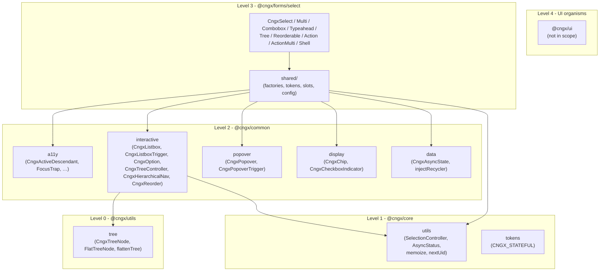
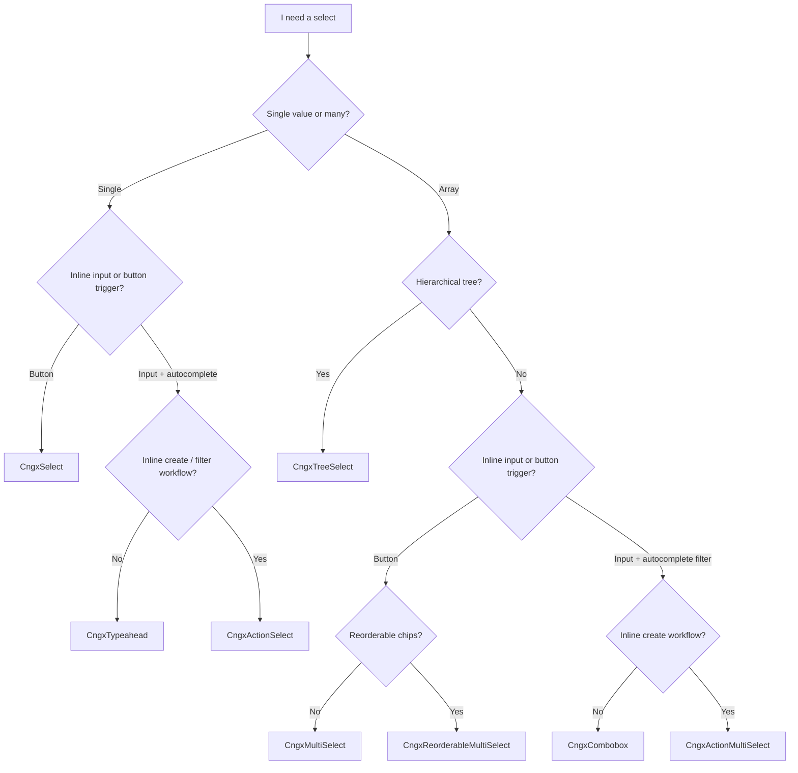
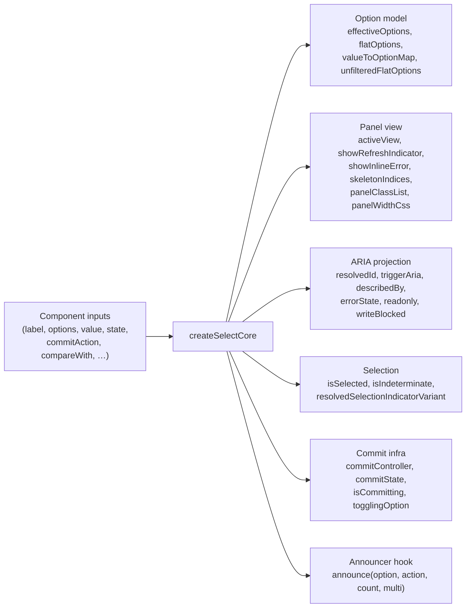
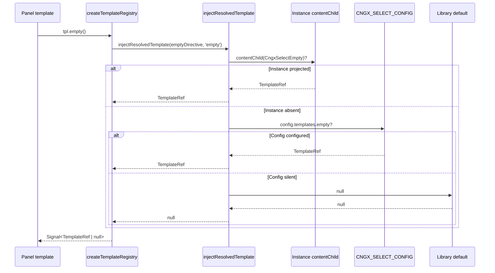
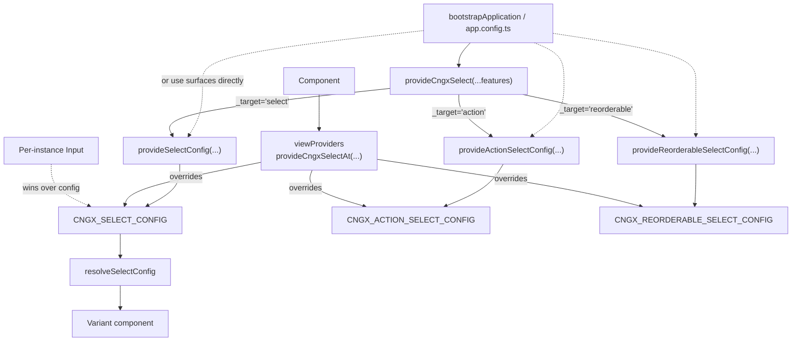
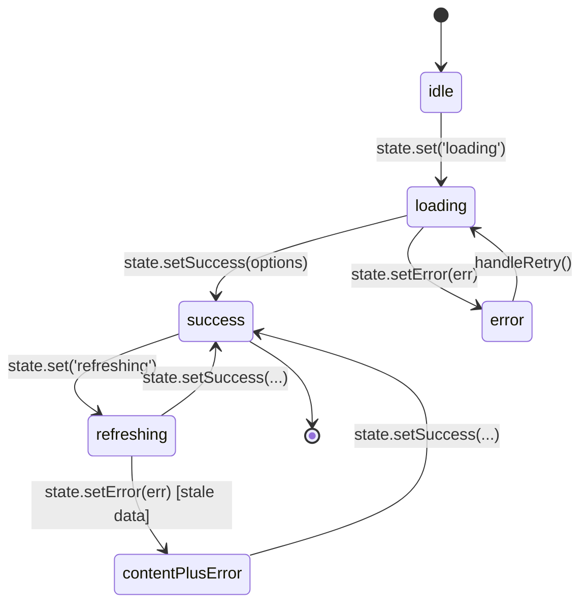
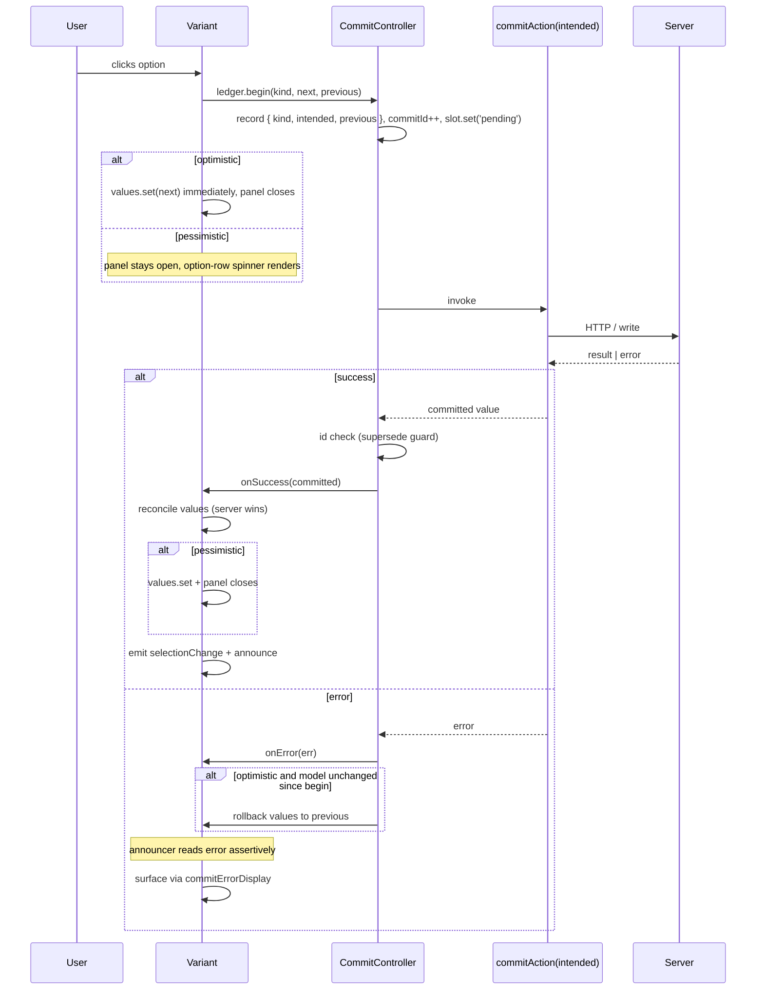
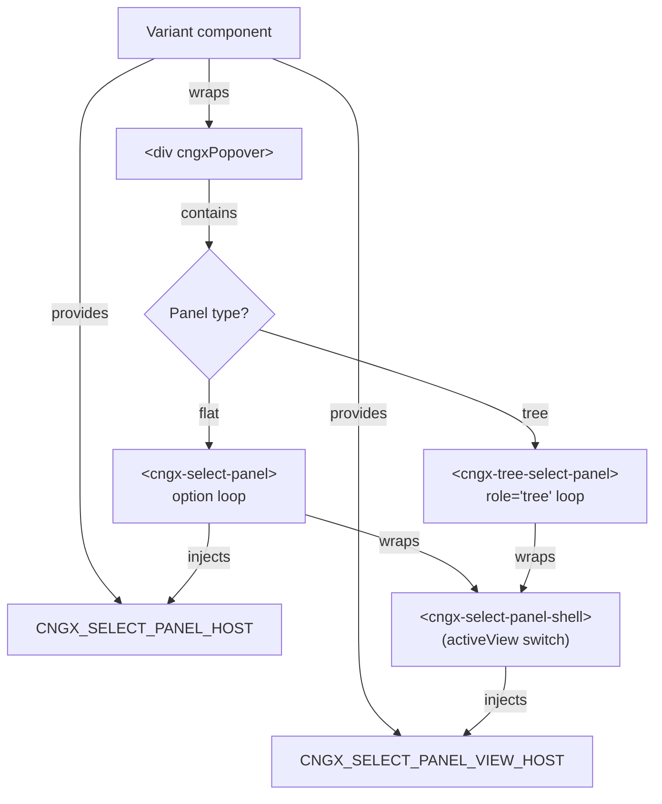

# `@cngx/forms/select` - Architecture

> The nine-composite select family - eight data-driven variants (single, multi, combobox, typeahead, tree, reorderable, action-select, action-multi-select) plus the declarative `<cngx-select-shell>`.
> Same commit machinery, same async-state machine, same slot system, nine different value-shape × trigger × option-source combinations.

This document is the canonical entry point for understanding how the family is composed, where to override behaviour, and which variant to reach for.
For day-to-day API reference (inputs, outputs, signals, CSS variables) see the compodoc output (`npm run docs:serve`) or the in-source JSDoc.

---

## Table of contents

- [Mission statement](#mission-statement)
- [The nine composites](#the-nine-composites)
- [Layer composition](#layer-composition)
- [Pick-your-select decision guide](#pick-your-select-decision-guide)
- [Shared infrastructure](#shared-infrastructure)
  - [Core factory `createSelectCore`](#core-factory-createselectcore)
  - [DI factory tokens (18)](#di-factory-tokens-18)
- [Template slot system](#template-slot-system)
  - [The shared slots](#the-shared-slots)
  - [Three-stage cascade](#three-stage-cascade)
  - [Default glyphs](#default-glyphs)
- [Configuration cascade](#configuration-cascade)
- [Async state machine](#async-state-machine)
- [Commit-action lifecycle](#commit-action-lifecycle)
- [A11y model](#a11y-model)
- [Forms integration](#forms-integration)
- [Panel-shell + panel split](#panel-shell--panel-split)
- [Mobile sheet](#mobile-sheet)
- [Class size and decompose strategy](#class-size-and-decompose-strategy)
- [How to extend](#how-to-extend)

---

## Mission statement

The select family delivers nine distinct widget shapes against three non-negotiable pillars from the cngx codebase philosophy:

1. **Derive over manage** - every reactive value is a `computed()` from
   a single source of truth. No subscription-driven local state, no
   manual sync between fields.
2. **Communication is architecture** - every state change emits to the
   appropriate channel: visual (DOM), semantic (ARIA), assistive
   (live region announcer). A11y is in the `computed()` graph, not
   bolted on.
3. **Composition over configuration** - small focused units.
   Nine composites rather than one monolith with `[multiple]` /
   `[searchable]` / `[hierarchical]` flags. Every internal logic
   block is a swappable DI factory; every visual element is a
   slot-overrideable template.

The family is **decompose-ready** - every `@Component` is a thin declaration delegating to extracted factories so consumers can swap implementations without forking.

---

## The nine composites

| Component | Value shape | Trigger | Panel | ARIA pattern |
|-|-|-|-|-|
| `CngxSelect`                 | `T \| undefined` | `<div role="combobox">`                     | flat listbox               | combobox + listbox |
| `CngxMultiSelect`            | `T[]`            | `<div role="combobox">` + chips             | flat listbox               | combobox + listbox |
| `CngxCombobox`               | `T[]`            | `<input role="combobox">` + chips           | flat listbox (filtered)    | combobox + listbox |
| `CngxTypeahead`              | `T \| undefined` | `<input role="combobox">`                   | flat listbox (filtered)    | combobox + listbox |
| `CngxTreeSelect`             | `T[]`            | `<div role="combobox">` + chips             | tree (`role="tree"`)       | combobox + tree    |
| `CngxReorderableMultiSelect` | `T[]` (ordered)  | `<div role="combobox">` + reorderable chips | flat listbox               | combobox + listbox |
| `CngxActionSelect`           | `T \| undefined` | `<input>` + action panel                    | flat listbox + action slot | combobox + listbox |
| `CngxActionMultiSelect`      | `T[]`            | `<input>` + chips + action panel            | flat listbox + action slot | combobox + listbox |
| `CngxSelectShell`            | `T \| undefined` | `<div role="combobox">`                     | projected `<cngx-option>` children, optional `<cngx-select-search>` | combobox + listbox |

Each composite provides `CNGX_FORM_FIELD_CONTROL` directly - no bridge directive needed. All nine share the same slot directives, the same config surface, the same announcer, and the same commit lifecycle. `<cngx-select-shell>` differs from `CngxSelect` only in where its options come from (projected `<cngx-option>` children instead of `[options]`).
What differs is the _value-shape adapter_ on top of `createSelectCore` and the _trigger-element template_.

---

## Layer composition

The family sits at Level 3 of the cngx dependency hierarchy (`@cngx/forms`). Each variant composes Level-2 atoms from `@cngx/common`:



A variant's `@Component` body is intentionally thin: it owns the template (with the variant-specific trigger markup) and the value-shape glue, then delegates everything else to the shared factories below.

---

## Pick-your-select decision guide



The variants are compared side by side in the examples app under `examples/stories/forms/select/`.

---

## Shared infrastructure

### Core factory `createSelectCore`

Every variant instantiates one `CngxSelectCore<T, TCommit>` in its field initialiser. The core is a plain factory (no `@Injectable`) that returns a bundle of pure-derivation signals every variant needs.



The core dispatches to `SelectionController<T>` for multi-mode membership tests (identity fast path, custom-comparator fallback) and holds the per-instance `commitController` instance.

What stays in the variant body:

- The trigger-element template.
- The value-shape adapter (single sets `value.set(v)`; multi calls
  `toggleOptionByUser(opt)`; tree calls `singleToggle(node)` /
  `cascadeToggle(node)`; reorderable handles position moves).
- Variant-specific output emissions (`selectionChange`,
  `optionToggled`, `cleared`, `reordered`).

### DI factory tokens (18)

Every shared factory has a corresponding DI token - providers can swap the default for telemetry-wrapped, retry-with-backoff, offline-queue, or audit-logging variants without forking any component.

| Token | Default factory | Concern |
|-|-|-|
| `CNGX_SELECT_COMMIT_CONTROLLER_FACTORY` | `createCommitController`       | Async-commit state machine + supersede semantics            |
| `CNGX_ARRAY_COMMIT_HANDLER_FACTORY`     | `createArrayCommitHandler`     | Multi/Combobox per-toggle + clear-all flow                  |
| `CNGX_SCALAR_COMMIT_HANDLER_FACTORY`    | `createScalarCommitHandler`    | ActionSelect commit flow                                    |
| `CNGX_REORDER_COMMIT_HANDLER_FACTORY`   | `createReorderCommitHandler`   | Reorderable position-move commits                           |
| `CNGX_CREATE_COMMIT_HANDLER_FACTORY`    | `createCreateCommitHandler`    | Action-host quick-create commit flow                        |
| `CNGX_DISPLAY_BINDING_FACTORY`          | `createDisplayBinding`         | Typeahead value ↔ input-text binding                        |
| `CNGX_COMMIT_ERROR_ANNOUNCER_FACTORY`   | `createCommitErrorAnnouncer`   | Scalar commit-error AT announce policy                      |
| `CNGX_TRIGGER_FOCUS_FACTORY`            | `createTriggerFocusState`      | Shared focus-state slot                                     |
| `CNGX_TEMPLATE_REGISTRY_FACTORY`        | `createTemplateRegistry`       | Three-stage template-slot cascade                           |
| `CNGX_PANEL_LIFECYCLE_EMITTER_FACTORY`  | `createPanelLifecycleEmitter`  | `panelOpen` → outputs + focus restore                       |
| `CNGX_SEARCH_EFFECTS_FACTORY`           | `createSearchEffects`          | `searchTerm` → debounced emit + auto-open                   |
| `CNGX_DISMISS_HANDLER_FACTORY`          | `createDismissHandler`         | Click-outside dismissal (action-dirty-aware)                |
| `CNGX_ACTION_HOST_BRIDGE_FACTORY`       | `createActionHostBridge`       | Action-host workflow bridge                                 |
| `CNGX_LOCAL_ITEMS_BUFFER_FACTORY`       | `createLocalItemsBuffer`       | Quick-create local-items persistence                        |
| `CNGX_PANEL_RENDERER_FACTORY`           | `createIdentityPanelRenderer`  | Panel render strategy (default = identity, opt-in recycler) |
| `CNGX_PROJECTED_OPTION_MODEL_FACTORY`   | `createProjectedOptionModel`   | Option model for projected `<cngx-option>` children (shell) |
| `CNGX_CHIP_REMOVAL_HANDLER_FACTORY`     | `createChipRemovalHandler`     | Chip ✕ disabled-guard + commit branch + WeakMap closure     |
| `CNGX_FLAT_NAV_STRATEGY`                | `createDefaultFlatNavStrategy` | PageUp/Down + typeahead-while-closed policy                 |

`CNGX_SELECTION_CONTROLLER_FACTORY` (`createSelectionController`, from `@cngx/core/utils`) is the multi-mode membership engine. The core and the tree variant inject it; it is a core token, so it is not counted in the table above.

All eighteen tokens are `providedIn: 'root'` with sensible defaults, overrideable per-component via `viewProviders`.
The override never breaks because the factory shape is captured in a `Cngx<Name>Factory` type alias - overrides match the exact signature.

---

## Template slot system

Every visible piece of a select panel has an override slot.
The slot directives live in `shared/template-slots.ts` and project a typed context object so consumer markup can read live state.

### The shared slots

`shared/template-slots.ts` exports the shared slot directives and `tree-select/` adds its own. The table covers the shared slots; the list below covers the variant-specific ones.

| Slot directive | Where it renders | Context |
|-|-|-|
| `*cngxSelectCheck`                                  | Selection-indicator next to each option | `{ option, selected, indeterminate, variant, position }`               |
| `*cngxSelectCaret`                                  | Trigger caret glyph                     | `{ open }`                                                             |
| `*cngxSelectOptgroup`                               | Group-header rows in the listbox        | `{ group }`                                                            |
| `*cngxSelectPlaceholder`                            | Trigger placeholder text                | `{ placeholder }`                                                      |
| `*cngxSelectEmpty`                                  | Panel "no options" body                 | `{ searchTerm, filtered, totalCount }`                                 |
| `*cngxSelectLoading`                                | First-load indicator body               | `{ progress?, retry }`                                                 |
| `*cngxSelectRefreshing`                             | Subsequent-load overlay                 | `{ previousCount }`                                                    |
| `*cngxSelectError`                                  | First-load error banner                 | `{ error, retry }`                                                     |
| `*cngxSelectCommitError`                            | Commit-error banner / inline            | `{ error, option, retry }`                                             |
| `*cngxSelectRetryButton`                            | Retry buttons across all 3 surfaces     | `{ retry, error, disabled, label }`                                    |
| `*cngxSelectLoadingGlyph`                           | Inner glyph of spinner/bar/dots         | `{}`                                                                   |
| `*cngxSelectClearButton`                            | Clear-all button                        | `{ clear, disabled }`                                                  |
| `*cngxSelectOptionLabel`                            | Option-row label rendering              | `{ option, selected, highlighted }`                                    |
| `*cngxSelectOptionPending`                          | Per-row commit-pending glyph            | `{ option }`                                                           |
| `*cngxSelectOptionError`                            | Per-row commit-error glyph              | `{ option, error }`                                                    |
| `*cngxSelectAction`                                 | Action panel slot (action-\* variants)  | `{ searchTerm, commit, close, isPending, dirty, retry, error, value }` |
| `*cngxSelectInputPrefix` / `*cngxSelectInputSuffix` | Input adornments (combobox + typeahead) | `{ disabled, focused, panelOpen }`                                     |
| `*cngxSelectSheetHandle` | Decorative drag handle of the mobile sheet (inside an `aria-hidden` wrapper) | `{ presentation, dragging }` |

`disabled` in the `*cngxSelectRetryButton` context is `true` only on the commit-error surface while the retried commit is pending (the variant's `isCommitting()`), so an override button can turn itself `aria-disabled` instead of starting a second retry. The load and inline refresh-error surfaces retry a load and always pass `false`.

Variant-specific slots that complement the table above:

- `*cngxSelectTriggerLabel` (single only)
- `*cngxMultiSelectChip` (multi + reorderable)
- `*cngxMultiSelectChipHandle` (reorderable only - drag-handle override)
- `*cngxMultiSelectMoveGlyph` (reorderable only - move-button glyph of the touch reorder list)
- `*cngxMultiSelectTriggerLabel` (multi)
- `*cngxComboboxChip` (combobox)
- `*cngxComboboxTriggerLabel` (combobox)
- `*cngxSelectChipOverflow` (multi + combobox + action-multi - `+N` overflow badge under `chipOverflow: 'truncate'` or `'fit'`; tree - the `+N` chip of its always one-line strip)
- `*cngxTreeSelectNode` (tree - node row override)
- `*cngxTreeSelectChip` (tree)
- `*cngxTreeSelectTriggerLabel` (tree)
- `*cngxTreeSelectNodeCount` (tree - selected-of-total count on a parent row)
- `*cngxTreeSelectFooter` (tree - panel footer with count and clear-all; the bottom bar in the sheet)
- `*cngxSelectSheetCount` (sheet header count; resolved by every variant, only the tree reports a count)

### Three-stage cascade



The cascade is `Instance contentChild → CNGX_SELECT_CONFIG.templates.<key> → null`.
Variant components declare their `contentChild` queries inline (Angular's AOT compiler requires the call as a direct field initialiser - NG8110 rejects it from helper functions) and pass them as a bundle to `createTemplateRegistry {...})`. The factory wires each query through `injectResolvedTemplate` to deliver the resolved `Signal<TemplateRef | null>` in one place.

### Default glyphs

The default clear, caret, tree twisty and reorder-list glyphs are SVGs drawn from the shared icon set in `@cngx/utils` (`CNGX_ICON_X`, `CNGX_ICON_CARET_DOWN`, `CNGX_ICON_CHEVRON_RIGHT`, `CNGX_ICON_GRIP_VERTICAL`, `CNGX_ICON_TRIANGLE_UP` / `_DOWN`) through `svg[cngxIconSvg]`. Each variant holds the icon in a `protected readonly` field; there is no select-local glyph table.
Consumers override via:

1. `*cngxSelectClearButton` / `*cngxSelectCaret` directives (highest precedence).
2. `[clearGlyph]` / `[caretGlyph]` Inputs (mid).
3. The default icon from the shared set (lowest).

The reorderable chip drag handle has no glyph fallback: `*cngxMultiSelectChipHandle` wins over `[chipDragHandle]` (app-wide default via `withDefaultDragHandle`), and with neither no grip renders. The move buttons of the touch reorder list follow the same shape: `*cngxMultiSelectMoveGlyph` wins over `[moveGlyph]` (app-wide default via `withDefaultMoveGlyph`), and with neither the list draws its default triangles. The projected glyph sits in an `aria-hidden` wrapper and gets `{ $implicit, direction }`.

The library deliberately ships no `<cngx-icon>` / `<cngx-button>` component - we assume consumers bring their own design system.

---

## Configuration cascade

Three configuration surfaces feed the family. Each is provided by a matching `provideXxxConfig(...features)` function plus a `*At` component-scoped twin.
A unified `provideCngxSelect(...)` aggregator dispatches features across all three by inspecting the hidden `_target` discriminator on each feature.



Resolution priority for any setting (`panelWidth`, `dismissOn`,
`ariaLabels.clearButton`, etc.):

1. **Per-instance Input** (`[panelWidth]`, `[clearButtonAriaLabel]`).
2. **`provideCngxSelectAt(...)` in `viewProviders`** (component scope).
3. **`provideCngxSelect(...)` at app root** (or one of the three
   individual providers).
4. **The active language pack** (`provideCngxI18n(withPack(...))` from
   `@cngx/core/i18n`) - copy keys only (`ariaLabels`, `fallbackLabels`):
   the pack's `select` section, formatted for the app locale.
5. **Library default** - `CNGX_SELECT_DEFAULTS` for settings,
   `CNGX_SELECT_LANGUAGE_EN` for copy.

A `*At` provider merges onto the configuration of the enclosing scope: it
reads the parent value of its token (`skipSelf`) and applies its features
on top, so a component-scoped `provideCngxSelectAt(withPanelWidth(...))`
keeps every app-root setting it does not name.

The `with*` features used inside `provide*` calls are typed so the
compiler catches typos and wrong-surface mixes within a single
`provideXxx` call. The aggregator widens the union to accept all
three feature types simultaneously.

Library defaults are English (`'Loading options'`, `'Save failed'`,
`'Reset selection'`, …). The usual way to another language is the
language pack, which covers the copy of every cngx lib at once:

```typescript
import { provideCngxI18n, withPack } from '@cngx/core/i18n';
import { CNGX_LANGUAGE_DE } from '@cngx/core/i18n/de';

bootstrapApplication(App, { providers: [provideCngxI18n(withPack(CNGX_LANGUAGE_DE))] });
```

Single keys are overridden on top of the pack through the config features:

```typescript
provideCngxSelect(
  withAriaLabels({
    clearButton: 'Auswahl zurücksetzen',
    chipRemove: 'Entfernen',
    statusLoading: 'Lade Optionen',
    statusRefreshing: 'Aktualisiere Optionen',
    fieldLabelFallback: 'Auswahl',
    commitFailedMessage: (label, detail) =>
      detail ? `${label}: Speichern fehlgeschlagen - ${detail}` : `${label}: Speichern fehlgeschlagen`,
  }),
  withFallbackLabels({
    refreshFailed: 'Aktualisieren fehlgeschlagen',
    refreshFailedRetry: 'Nochmal versuchen',
    commitFailed: 'Speichern fehlgeschlagen',
    commitFailedRetry: 'Nochmal versuchen',
  }),
);
```

---

## Async state machine

The optional `[state]` input drives the panel view via `resolveAsyncView()` from `@cngx/common/data`.
The view is a discriminated union the panel-shell switches against.



`activeView()` resolves to one of `'skeleton' | 'content' | 'empty' | 'none' | 'error' | 'content+error'`.

The panel-shell renders:

| `activeView()` | Behaviour |
|-|-|
| `'skeleton'`                               | Full-panel loading body - variant from `loadingVariant` config (skeleton/spinner/bar/text) |
| `'empty'` / `'none'`                       | `*cngxSelectEmpty` slot or the configured fallback label                                   |
| `'error'` (first load)                     | `*cngxSelectError` slot or the default error banner with retry                             |
| `'content+error'` (stale + refresh failed) | Options visible + inline error above                                                       |
| `'content'` + `showRefreshIndicator()`     | Options visible + 2px shimmer overlay                                                      |
| `'content'` (no refresh)                   | Options visible only                                                                       |

Per-instance overrides: `[loading]` (boolean), `[loadingVariant]`, `[skeletonRowCount]`, `[refreshingVariant]`, `[retryFn]`.
The `(retry)` output fires on every retry click, letting consumers re-fetch.

---

## Commit-action lifecycle

Bind `[commitAction]` to a function returning `Observable | Promise | T | undefined` and the family routes user picks through it. Two modes, identical state machine.



**Commit ledger.** Every commit handler begins through one ledger per
commit controller (`shared/internal/commit-ledger.ts`, layered over
whatever `CNGX_SELECT_COMMIT_CONTROLLER_FACTORY` returns). The
controller keeps the async-state slot and the supersede id; the ledger
owns the commit record and the model side: reconcile on success,
guarded rollback on failure (optimistic mode only, and only when nothing
else wrote the model while the commit was pending), the announcement and
Retry.

**Rollback target.** The `previous` of a begin is the ledger's
baseline: the last value no pending commit wrote. A commit that
supersedes a pending one therefore rolls back to the confirmed value,
never to the unconfirmed optimistic value of the commit it replaced.
The array toggle and chip-removal flows read this target from the
ledger, so no composite mirrors a "last committed" value of its own.

**Recorded kinds.** The record carries the kind of the commit
(`'select' | 'toggle' | 'clear' | 'reorder' | 'tree'`), the intended and
previous value, the option and kind-specific detail (`fromIndex` /
`toIndex` for a reorder). Retry replays the recorded kind, never the
kind some handler saw last.

**Retry routing.** A composite with more than one commit source (scalar
pick and quick-create, toggle and clear-all, tree toggle and clear)
wraps each handler through the controller's retry router. Starting a
commit claims the router for that handler, so the commit-error Retry
reaches the handler that started the failed commit, also when a
consumer swapped it through its factory token.

**Settling.** A `commitAction` settles on its first value. An
Observable that completes without a value settles as an error
(`CNGX2025`, plus a dev warning), so the panel never stays blocked on a
commit that has nothing to return; a quick-create commit that resolves
`undefined` settles the same way (`CNGX2027`).

**Supersede semantics.** Every `begin(...)` increments a monotonic
`commitId`. Outcome callbacks check their captured id against the
current counter; if a newer commit started in the meantime, the
callback no-ops. Consecutive picks therefore never race.

**Three error surfaces** controlled by `commitErrorDisplay`:

- `'banner'` (default) - `*cngxSelectCommitError` slot or a default alert banner above the option list.
- `'inline'` - a per-row `*cngxSelectOptionError` glyph on the failed option (visual-only, AT feedback via `announcer.announce(..., 'assertive')`).
- `'none'` - no built-in UI; bridge via `<cngx-toast-on />`,
  `<cngx-banner-on />`, or any `CNGX_STATEFUL`-aware transition component on the host.

The `commitState` signal is exposed via `CNGX_STATEFUL`, so transition bridges work with zero additional wiring.

---

## A11y model

Each variant follows the appropriate WAI-ARIA pattern.
Common properties are derived from the same `triggerAria()` projection on `createSelectCore`, ensuring identical behaviour across variants. Its field half (id, `aria-labelledby`, `aria-describedby`, `aria-errormessage`, `aria-invalid`, `aria-required`, `aria-busy`, `aria-readonly`, disabled) comes from `createFieldControlAria` in `@cngx/forms/field`, the projection every field control shares; the select feeds its own `[id]`, `aria-labelledby`, `[required]`, failed commit and loading / committing state in as control-side hooks.

| Variant | Trigger element | ARIA pattern |
|-|-|-|
| Single, Multi, TreeSelect, Reorderable | `<div role="combobox">`                            | combobox + listbox / tree popup |
| Combobox, Typeahead, Action\*          | `<input role="combobox" aria-autocomplete="list">` | inline-input combobox           |

The `<div role="combobox">` choice on the chip-carrying variants is deliberate: WAI-ARIA 1.2 forbids interactive children inside `<button>` (chip remove buttons would nest), so a `div` with a click handler fronts the combobox semantic.

**Two typing windows.** `typeaheadDebounceInterval` is the buffer window of the closed-trigger typeahead on the button-trigger variants (Single, Multi, Reorderable, Shell): keys typed within it join one query. `searchDebounceMs` is the wait between the last keystroke in a search input and the `searchTerm` update, on Combobox, Typeahead, Action\* and the shell's `<cngx-select-search>`. Each has its own config key (`withTypeaheadDebounce`, `withSearchDebounce`) and per-instance input. Every search input debounces through the `CngxSearch` atom (`CngxListboxSearch` on the input variants, `CngxSearch` itself on `<cngx-select-search>`), whose `flush()` and `cancel()` settle a pending term on Enter and on a panel close.

**Readonly.** A readonly bound field (`aria-readonly`, from the field
projection) keeps the select browsable and refuses every write. The
core derives `writeBlocked = disabled() || readonly()`; every write
path (pick, clear, chip remove, reorder, typeahead-while-closed, the
activation dispatcher) reads that one signal, while opening the panel
and keyboard browsing read `disabled()` only. Clear buttons and chip
remove affordances are not rendered while writes are blocked.

**Live ARIA on the trigger**: `aria-disabled`, `aria-invalid`, `aria-required`, `aria-busy`, `aria-describedby`, `aria-errormessage` come from `core.triggerAria`. `aria-expanded`, `aria-haspopup` and `aria-controls` have one writer, `CngxPopoverTrigger`: the template binds `[haspopup]="sheetWiring.triggerHaspopup()"` and `[controls]="sheetWiring.triggerControls()"` (the listbox / tree id while anchored, `'dialog'` and the sheet id while modal).
All are reactive computeds - they always reflect the current state, never go stale.

**TreeSelect's tree panel** uses `CngxActiveDescendant` (vertical nav)

- Home/End + typeahead) composed with `CngxHierarchicalNav`
  (ArrowLeft/Right collapse-and-traverse) on the same element - no double-fire because the two directives own disjoint key sets.
  Per-node `role="treeitem"` carries `aria-level`, `aria-posinset`, `aria-setsize`, `aria-expanded` (only on parents), `aria-checked` (true / false / `mixed` for partial cascade selection - APG checkbox-tree pattern), `aria-disabled`, all reactive.
  The treeitem is the one AT channel: the row checkbox and the parent-row count (`2/3`) are `aria-hidden`, because `aria-checked` already carries what they show. Under the touch floor the checkbox wrapper is the selection tap target and a pointer tap on the row expands a parent: the row expands only for the `click` that ends a `pointerdown` with `pointerType` `touch` or `pen` on that row (`rowTapExpands` on `CNGX_TREE_SELECT_PANEL_HOST`, read from the touch-floor signal). Every other activation, including a screen reader's double tap (a click without pointer events), runs `handleSelect`; AT expands through `aria-expanded`. The footer clear-all is `aria-disabled` and described by the count while nothing is selected, so it keeps focus instead of dropping it to `body`.

**Live region announcer.** `CngxSelectAnnouncer` is `providedIn: 'root'` and announces selection changes through a global polite live region. While a mobile sheet is modal and open, the variant's `CngxScopedSelectAnnouncer` speaks through the region inside the sheet instead (see [Mobile sheet](#mobile-sheet)).
`CngxSelectAnnouncerConfig.format()` builds the sentence; override for custom locales or sentence shapes.

**Focus restoration.** On panel close, focus returns to the trigger. Only an open -> closed flip restores; the closed state a select mounts in never moves focus.
This lives in `createPanelLifecycleEmitter` (one factory across all variants), wrapped in a `queueMicrotask` so the focus write happens after the popover-close DOM mutation settles.

**Focus model.** Two focus notions, one source each:

- **Field focus and touched** follow focus entering and leaving the whole host (`(focusin)` / `(focusout)` with `relatedTarget` outside the host), the rule `CngxFormBridge` and `createFieldControlAria` already apply. Every variant renders its `cngxPopover` inside the host, so moving into the own panel (tree container, `<cngx-select-search>`, retry or action button) is not a leave: the form-field keeps `cngx-field--focused` while the panel holds focus, and `touched` flips only once focus moves outside the host.
- **Trigger focus** (`CNGX_TRIGGER_FOCUS_FACTORY`) tracks the trigger or the combobox input alone. It drives the display binding and the slot contexts' `focused`, and hosts the variant reactions (openOn focus, `clearOnBlur`).

A mouse press on an option never moves focus: `CngxOption` cancels `mousedown`, so a pick takes the same path as an Enter pick with focus on the owner. The tree container cancels `mousedown` for the same reason - `CngxActiveDescendant` reads keys only while the container has focus, and a focusable control in a projected node row would take it. The default row's twisty is an `aria-hidden` span, not a button: the treeitem is named by its label alone and `aria-expanded` carries the state.

A focused control that disappears would drop focus to `body`, which reads as leaving the field. Chip x, clear, clear-all and retry (the built-in buttons and the `remove` / `clear` / `retry` callbacks in the chip, clear-button and retry slot contexts) move focus to the owner first. A panel close does the same, because `CngxPopover` blurs focus inside the panel before it hides it: `close()`, the commit-mode hides and the `closeOnSelect` hide of `createADActivationDispatcher` (via `beforeHide`) all refocus the owner when focus is inside the host and is not the owner. Under `restoreFocus: false` a close leaves focus alone. The refocus reuses the close restore's suppression window, so an `openOn: 'focus'` trigger does not reopen.

---

## Forms integration

The family is **Signal-Forms-first**. Every variant provides `CNGX_FORM_FIELD_CONTROL` directly - drop a `<cngx-XXX>` inside a `<cngx-form-field [field]="myField">` and bidirectional sync runs through `CngxFormFieldPresenter`.

Reactive Forms remain supported via the one-shot `adaptFormControl` adapter:

```typescript
import { adaptFormControl } from '@cngx/forms/field';

protected readonly rfControl = new FormControl<string>('green', {
  validators: [Validators.required],
  nonNullable: true,
});
protected readonly rfField = adaptFormControl(
  this.rfControl,
  'color',
  inject(DestroyRef),
);
```

Then bind the resulting `Field<T>` to `<cngx-form-field [field]="rfField">` exactly as for native Signal Forms.

`createFieldSync` (in `projects/forms/field/field-sync.ts`, exported from `@cngx/forms/field`) is the shared bridge - two `effect()`s install bidirectional `componentValue ↔ field.value()` sync, both directions guarded by `valueEquals` to suppress redundant writes. The select family reaches it through `shared/field-sync.ts`, which gates the sync on `CNGX_SELECT_DISABLE_FIELD_SYNC`: a subtree can opt out of value-sync (while keeping the disabled / focused / errorState bridge) by providing that token truthy - used by composites like `CngxFilterBuilderFormFieldControl` that are themselves the form-field control, so their inner selects never sync the composite's object value.

### Why the select family has no ControlValueAccessor

A `ControlValueAccessor` is imperative by construction: `writeValue` -> `registerOnChange` -> `registerOnTouched` are callbacks outside the signal graph, and every control that implements them re-plumbs the same `onChange` / `onTouched` wiring. The select family carries one source of truth instead - the primary `model()` (`value` / `values`) - and bridges to a form through `CNGX_FORM_FIELD_CONTROL` plus `createFieldSync`, so value, disabled, focused and error state all derive from signals the trigger already shows. A consumer who has a CVA control (Material, native, third-party) still bridges it with `cngxBindField`; CNGX just never authors one on its own atoms. Reactive Forms reach the same surface through the one-shot `adaptFormControl` above, not through a CVA.

---

## Panel-shell + panel split

The shared frame around every variant's panel body is `CngxSelectPanelShell` - owns the `activeView()` switch, the loading variants, the empty/error states, the refresh indicator, and the commit-error banner.
The variant projects only the variant-specific body (option loop / tree loop) via `<ng-content />`.



`CngxSelectPanelHost<T>` extends `CngxSelectPanelViewHost<T>`.
The narrower view-host contract is what the shell reads - keeps the shell value-shape-agnostic so `CngxTreeSelectPanel` and any future panel variant compose uniformly.
Tree-select provides `CNGX_SELECT_PANEL_VIEW_HOST` from `core.createPanelViewHost(...)` and its own `CNGX_TREE_SELECT_PANEL_HOST` with `useExisting: self`.

**Panel-host delegation.** The core builds the panel host. `core.createPanelHost(extras)` merges the keys the core owns (`CngxSelectCorePanelKeys`: async view, indicator resolution, option predicates, commit-error state and the rest) with the composite's `extras`, whose type is `Omit<CngxSelectPanelHost<T>, CngxSelectCorePanelKeys>`, so the compiler names every key the composite still owes (`tpl`, `panelOpen`, `activeId`, `errorContext`, ...). `core.createPanelViewHost(extras)` is the same merge for the narrow contract. A composite provides both tokens from one object with `useFactory: () => inject(Cmp).panelHost`; the core-owned keys no longer need a pass-through field on the component. `activeView`, `showInlineError` and `isCommitting` may be overridden through `extras` (typeahead hides a closed-panel load error, the action variants merge the quick-create commit).

**Shared trigger gesture.** The guard that keeps the click of a focus-opening pointer press from toggling the panel straight back shut lives once in `createOpenOnFocusGesture` (`shared/internal/open-on-focus-gesture.ts`); the button-trigger composites (single, multi, reorderable, tree, shell) reach it through `createButtonTriggerHandlers` (`shared/internal/button-trigger-handlers.ts`) instead of each copying the pointerdown/focus/click dance. The four input-owned composites share their focus, blur, retry and wrapper-click handlers through `createInputHostHandlers` (`shared/internal/input-host-handlers.ts`).

---

## Mobile sheet

On a coarse, narrow viewport every variant opens its panel as a modal sheet instead of an anchored popover. There is still one panel host: the variant's `cngxPopover` element carries `[cngxPopoverSheet]` from `@cngx/common/popover`, and the presentation (`anchored`, `sheet`, `fullscreen`) is a switch on that atom. The breakpoint lives once in `cngx-popover-sheet.css`; no TypeScript reads a length.

**Cascade.** `[presentation]` on the variant, else `CNGX_SELECT_CONFIG.mobileSheet` (`withMobileSheet('off')` maps to `'anchored'`), else `'auto'`. `'auto'` resolves through the breakpoint to the variant's static height fact: `fullscreen` for the variants led by a text input (`CngxCombobox`, `CngxTypeahead`, `CngxActionSelect`, `CngxActionMultiSelect`, `CngxSelectShell` with a `<cngx-select-search>`), a content-sized `sheet` for the rest. The cascade is `createPresentationRequest` in `shared/internal/select-core.ts`, read by every variant through the core's `resolvedPresentationRequest`.

**Wiring.** `createSelectSheetWiring` (`shared/internal/select-sheet-wiring.ts`) is the one bundle per variant: the presentation request, `sheetModal` / `sheetAnchored`, `closeBlocked` (a pessimistic commit is pending), the Escape gate bound to `[closeOnEscape]`, the outside-click gate bound to `cngxClickOutside [enabled]`, `handleSheetClose`, `escapeClose` for in-sheet inputs, and the value of the internal `CNGX_SELECT_SHEET_HEADER_HOST`. It also resolves the variant's dismiss handler, so the anchored outside click and the sheet close vectors share one policy.

**One close path per vector.** The atom never closes itself (`[closeOnRequest]="false"`): header swipe, outside tap, Android back, X and Done all arrive at `handleSheetClose`, which runs `DismissHandler.handleSheetClose` (pending commit, then the action dirty guard, then `dismissOn` for an outside tap). While the sheet is modal the variant's own `cngxClickOutside` is off, so one tap has one path. While a pessimistic commit is pending no vector closes the sheet, Escape included; on a desktop Escape and outside click behave as before.

**Header.** `<cngx-select-sheet-header>` is the panel's first child and is hidden while anchored. It shows the field label as the dialog title (read once per open from the form-field host's `labelId`; `[sheetLabel]` wins, `[label]` and `ariaLabels.fieldLabelFallback` follow), X, Done on the multi and input variants, and a header input on the input variants that writes through the trigger input, so the trigger's `CngxSearch` stays the one search term. The handle is decorative; `*cngxSelectSheetHandle` replaces it.

**Focus.** Focus moves into the sheet inside `show()`, onto the listbox or the tree (`tabindex="0"` only while modal), so a tap open raises no soft keyboard and a screen reader reads the dialog title and the list. The header input or the `<cngx-select-search>` input takes focus only when the open came from the keyboard: a key or typed text on the trigger, or focus that reached the trigger without a pointer. `CngxSelectSheetTrigger` forwards those trigger events to the wiring in the capture phase, before the trigger's own handlers open the panel, and the search registers with the sheet under a signal condition (`searchLeads`), so the sheet reads it inside the opening call. On close the variant moves focus back to its trigger in the atom's synchronous `(closing)` output, before the close transition, so focus never falls to `body` and the field is not marked touched. On the modal path the trigger input carries `inputmode="none"` for that refocus: the host-focus and lifecycle-emitter refocus brackets call the wiring's `handleTriggerRefocus`, which starts the keyboard hold and writes the value once ahead of the `triggerInputMode` binding, since the refocus runs inside the closing tap before change detection. The next pointer down, key or blur on the trigger input ends the hold, so the restore never raises the soft keyboard and a later tap or key behaves as usual. The anchored panel never holds.

**Announcements.** Each variant provides `CngxScopedSelectAnnouncer` in place of `CngxSelectAnnouncer`. While the sheet is modal and open it speaks only through the region inside the sheet, with the politeness each call passes; otherwise it delegates to the next `CngxSelectAnnouncer` up the tree, so an app-level override keeps working.

**Scroll.** In the sheet only the listbox (or the tree panel) scrolls; the popover host does not. The virtualization scroll element follows the presentation.

**Summary trigger.** Under the touch floor the five multi-value selects render `<cngx-select-summary>` (`shared/internal/summary/`) in place of the chip strip. The floor is `injectTouchFloorSignal()` (`shared/internal/touch-floor.ts`): one computed over the resolved `--cngx-target-min` of the host element, which already folds `any-pointer: coarse`, `data-touch` and `.cngx-touch-*` and their `off` mirrors. It re-reads on every resize of the host and on a flip of the coarse-pointer query, and the query stands in before the first resize entry. `createSelectSummary()` derives the summary from the same displayed list the chips render: the chip strip is its `createChipOverflow` derivation, truncated at one value while the floor is on, so the label, the `+N` count and the hidden options come from one source. Off the floor the same derivation takes its cap from the variant: `maxVisibleChips` under `'truncate'`, and under `'fit'` the count `fitChipCount()` (`shared/internal/chip-fit.ts`) derives from the snapshot `CngxSelectChipFitStrip` measures on the strip (strip width, gap, the `--cngx-select-chip-fit-badge-reserve` reserve, every chip slot width), falling back to `maxVisibleChips` before the first measurement. Every measured size depends on the strip alone (slots are capped at the strip minus the reserve, hidden slots stay in layout, the badge slot is exactly the reserve wide), so the count never feeds back into its input. `CngxReorderableMultiSelect` renders `'fit'` as `'scroll-x'` and `CngxTreeSelect` keeps its own one-line count cap. `*cngxSelectChipOverflow` replaces the summary badge through the same context. AT exposure: the div-based triggers render `fullText` in a visually hidden span (`exposeValue`); the input-led variants (`CngxCombobox`, `CngxActionMultiSelect`) reference `accessibleText` through `aria-describedby`, gated on a non-empty text and on no trigger-label slot. Known limit: a subtree `data-touch` flip that changes no box size is picked up on the next resize only.

**Reorder list.** Under the floor `CngxReorderableMultiSelect` shows `<cngx-select-reorder-list>` (`shared/internal/reorder-list/`) above the options in the panel or sheet, while at least one value is selected. The trigger is then a plain summary, not a `CngxReorder` group. The list is presentational: rows, copy and the modifier come in as inputs, and the host owns the commit. Three paths emit one `CngxReorderEvent` through `reordered`: the row handle drag, the `CngxReorder` modifier keys on a focused row button, and the move buttons. A boundary button stays focusable with `aria-disabled` and references its reason only while that reason applies. While a commit is pending (`busy`, under the default freeze) every path is frozen, the list gets `aria-busy`, and each move button references the `commitPending` reason. After a move, focus follows the moved row to the same button. The host passes the resolved move glyph (`*cngxMultiSelectMoveGlyph` > `[moveGlyph]`) as `[moveGlyph]`; `null` keeps the triangles, sized by `--cngx-select-reorder-move-size`.

## Class size and decompose strategy

Each composite's `*.component.ts` file runs from roughly 1080 to 1410 lines (730 to 940 lines without comments), depending on value-shape complexity.
Sub-200-LOC targets are structurally unreachable under the locked patterns (no inheritance, no abstract base classes).
The 18 DI tokens + the slot system ARE the real decompose strategy: they eliminate cross-variant duplication and let consumers swap implementations.

**Atomic-decompose contract.** Each variant is decompose-ready:

- Thin `@Component` declaration.
- `hostDirectives: []` minimal - most variants use only the popover trigger directives.
- DI-token contracts for every internal logic block.
- CSS split: `select-base.css` (structural, family-shared) +`<variant>.component.css` (trigger skin). The schematic can eject the trigger skin into the consumer's project while keeping the base styles linked from the library.

**What is genuinely variant-specific** and does NOT factor out:

- Trigger template markup (button vs input vs chip-strip-with-input).
- Public API surface (single `value` vs `values: T[]` vs `treeValues`).
- AD-activation glue (the activated payload's shape varies).
- Field-sync wiring (single owns scalar `value`; multi/tree own arrays; typeahead owns `value + display.writeFromValue` integration).

Every other concern is shared.

---

## How to extend

A few representative extension paths.

**Add a new template slot.**

1. Add the directive class + context interface in `shared/template-slots.ts`.
2. Add the slot key to the `templates` type of `CngxSelectConfig` and to `CNGX_SELECT_DEFAULTS.templates` in `shared/config.ts`. `CngxSelectTemplateContexts` is derived from that type, so it needs no edit.
3. Add the slot to `CngxSelectTemplateRegistryQueries` + `CngxSelectTemplateRegistry` in `shared/template-registry.ts`, then wire `injectResolvedTemplate(...)` inside `createTemplateRegistry`.
4. Each variant declares the corresponding `contentChild` and adds the field to the registry call.
5. Bind the resolved `host.tpl.<slot>()` in the panel template with an `@else` default.
6. Export the directive + context from `public-api.ts`.

**Add a new ariaLabels key.**

1. Add the optional field on `CngxSelectAriaLabels` in `shared/config.ts`.
2. Add the key to `CngxSelectLanguageSection` and its English text to `CNGX_SELECT_LANGUAGE_EN` (`i18n/select-language-section.ts`), then map it in `selectCopyFrom` (`i18n/select-i18n.ts`).
3. Read it through `config.ariaLabels().<key>` inside a `computed()` or template at the consumption site (variant or panel-shell); no literal fallback.

**Override an internal logic block enterprise-wide.**

1. Implement a custom factory matching the corresponding `Cngx<Name>Factory` type alias.
2. Provide it at app root:
   ```typescript
   {
     provide: CNGX_SELECT_COMMIT_CONTROLLER_FACTORY,
     useValue: <T>() => createMyTelemetryCommitController<T>({ ... }),
   }
   ```
3. Every select-family variant picks it up automatically.

**Add a tenth composite.**

1. Build the trigger template; pick the appropriate ARIA pattern.
2. Instantiate `createSelectCore<T, TCommit>` in a field initialiser.
3. Provide `CNGX_FORM_FIELD_CONTROL` (`useExisting: self`) and `CNGX_STATEFUL` for transition-bridge integration.
4. Build the panel host in the core: `readonly panelHost = this.core.createPanelHost({...})` for an option-loop panel, `core.createPanelViewHost({...})` otherwise. The extras type names every key the composite still owes; the core fills the rest. Provide both tokens from that object with `useFactory: () => inject(Cmp).panelHost` (only `CNGX_SELECT_PANEL_VIEW_HOST` for a view-host-only panel). Do not re-declare core keys as pass-through fields.
5. Wire the trigger handlers from the shared helper for the trigger kind: `createButtonTriggerHandlers` for a button trigger, `createInputHostHandlers` for an input-owned trigger (`shared/internal/`).
6. Wire `CNGX_PANEL_LIFECYCLE_EMITTER_FACTORY`, `CNGX_TEMPLATE_REGISTRY_FACTORY`, and the appropriate commit handler factory. `createADActivationDispatcher` reads only `CngxActivationDispatcherCore<T>` (`writeBlocked`, `findOption`) from the core, so a composite can hand it the select core or any object with those two members.
7. Reuse the value-shape glue closest to your variant (`createArrayCommitHandler` for arrays, `createScalarCommitHandler` for singles, `createReorderCommitHandler` for ordered arrays).
8. Export the component + change-event interface from `public-api.ts`.
